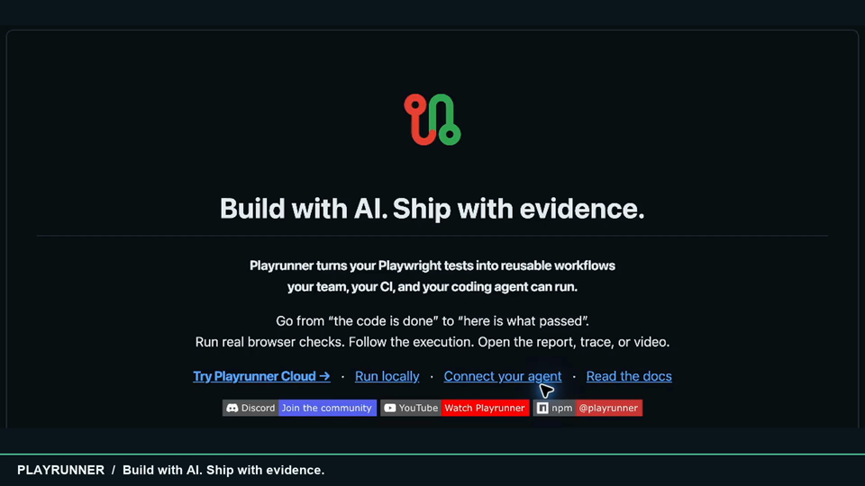
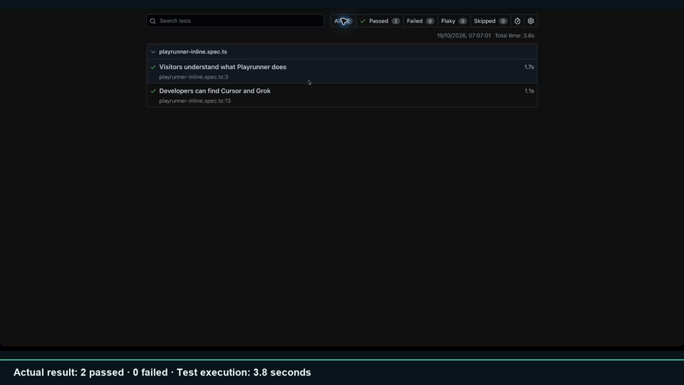
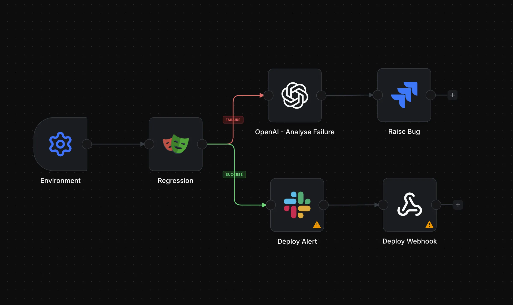
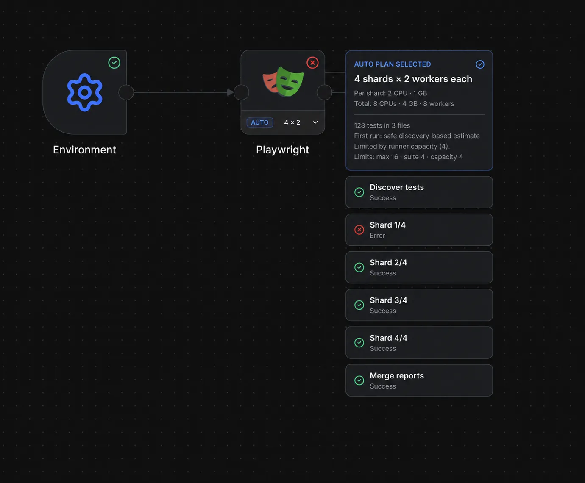

<p align="center">
  
</p>

<h1 align="center">Build with AI. Ship with evidence.</h1>

<p align="center">
  <strong>Playrunner turns your Playwright tests into reusable workflows<br />
  your team, your CI, and your coding agent can run.</strong>
</p>

<p align="center">
  Go from “the code is done” to “here is what passed”.<br />
  Run real browser checks. Follow the execution. Open the report, trace, or video.
</p>

<p align="center">
  <a href="https://playrunner.cloud"><strong>Try Playrunner Cloud →</strong></a>
  &nbsp;&nbsp;·&nbsp;&nbsp;
  <a href="#quick-start">Run locally</a>
  &nbsp;&nbsp;·&nbsp;&nbsp;
  <a href="https://playrunner.dev/docs/mcp/connect">Connect your agent</a>
  &nbsp;&nbsp;·&nbsp;&nbsp;
  <a href="https://playrunner.dev/docs/overview/">Read the docs</a>
</p>

<p align="center">
  <a href="https://discord.gg/4zPdBy3DwU"></a>
  <a href="https://www.youtube.com/@playrunnerdev"></a>
  <a href="https://www.npmjs.com/org/playrunner"></a>
</p>

## See Playrunner in a minute

| Product overview · 61 seconds                                                                                                       | Workflow & evidence · 51 seconds                                                                                                                   |
| ----------------------------------------------------------------------------------------------------------------------------------- | -------------------------------------------------------------------------------------------------------------------------------------------------- |
| [](docs/static/videos/playrunner-overview.mp4) | [](docs/static/videos/playrunner-workflow-demo.mp4) |
| A narrated tour of reusable workflows, agent connections, and sharding.                                                             | A fresh local workflow: two passing checks, the report, and screenshot evidence.                                                                   |

Recorded with OBS and narrated with AI on 19 October 2026. The overview shows
product examples; the workflow video tours a real local run’s saved configuration,
passing report, and screenshot evidence. [Video notes and transcripts →](docs/static/videos/README.md)

## Your agent wrote it. Now check it.

A working-looking screen is a good start. A repeatable test with an inspectable
result is something your team can build on.

Playrunner gives AI-assisted developers and test teams a shared place to run
Playwright, reuse environments and browser sign-ins, and investigate failures.
Keep your existing tests. Give them a workflow you can run again after the next
change.

## For vibe coders and their favourite agents

Connect a compatible MCP client to Playrunner Cloud, then ask:

> Run my checkout smoke workflow once. Wait for it to finish, tell me which
> tests passed or failed, and include the report links.

The agent can discover projects, create workflows, start runs, and inspect the
returned evidence from the same conversation. Your saved workflows remain
available to your teammates and CI.

**Codex · Claude · Cursor · Gemini CLI · Antigravity · Grok**

Connection steps and capabilities vary by client. Use a client with remote
Streamable HTTP and OAuth support, or the CLI from a shell-capable agent.
[Choose your connection →](https://playrunner.dev/#agent-connections)
[Read the MCP guide →](docs/docs/mcp/index.md)

## From a test suite to a repeatable check

1. **Bring a test.** Use your existing Playwright repository or start with an
   inline script.
2. **Give it a home.** Choose an environment, an optional Authentication Profile,
   and where the workflow runs.
3. **Run it your way.** Use the visual editor, your agent, the CLI, or a schedule.
4. **Follow the evidence.** Inspect test results, logs, and the report and
   artefacts produced by the run. A started job is not a passing test.

```text
Your agent / CI / schedule
           ↓
      Environment → Playwright → Pass or fail → Your next action
                         ↓
              Report · traces · screenshots · video
```



<p align="center">
  <em>Your tests, environments, runners, and next steps. One visible workflow.</em>
</p>

## Less test infrastructure. More useful feedback.

| What you need                          | What Playrunner brings                                                    |
| -------------------------------------- | ------------------------------------------------------------------------- |
| **A workflow the team can understand** | A visual canvas for tests, conditions, branches, and follow-up actions.   |
| **Faster feedback from larger suites** | Automatic sharding with capacity-aware planning and one merged report.    |
| **A choice of where tests run**        | Local Docker, managed cloud runners, and self-hosted execution.           |
| **A way to investigate a failure**     | Live node state and logs, plus Playwright reports and captured artefacts. |
| **Tests that start signed in**         | Reusable Authentication Profiles, isolated by environment.                |
| **Less secret copying**                | Managed environments and credentials, referenced by your workflows.       |
| **A useful next step**                 | Integrations for GitHub, Slack, Jira, AI analysis, webhooks, and more.    |



<p align="center">
  <em>Four shards. One merged report. Failed tests stay visible.</em>
</p>

## Give your CI the same workflow

Start a saved workflow, stream its progress, and return a failing exit code when
the workflow fails, is cancelled, or times out:

```bash
export PLAYRUNNER_URL='https://playrunner.cloud'
export PLAYRUNNER_API_KEY='<your-api-token>'

npx playrunner WORKFLOW_ID
```

Prefer workflows as code? Keep the definition alongside your application:

```bash
npx playrunner workflow create --file playrunner-workflow.json
```

[CLI run guide →](docs/docs/cli/run-workflow.md) ·
[Workflow definitions →](docs/docs/cli/create-workflow.md)

<details>
<summary><strong>Need a signed-in browser? Reuse an Authentication Profile.</strong></summary>

Capture a browser session interactively, then select the profile on your
Playwright node. Playrunner restores the stored session for the execution
without storing your identity-provider password.

For Playrunner Cloud, pair your computer with the authentication companion:

```bash
npm install --global playrunner@latest
playrunner login
playrunner auth connect
```

Keep the companion open while capturing or refreshing the session. Hosted
workflow runs can restore the encrypted stored state without the companion
remaining connected.

[Authentication Profiles tutorial →](https://playrunner.dev/docs/tutorials/authentication-profiles/)

</details>

## Quick start

### Prerequisites

- Docker Desktop
- Node.js 20+
- npm

### Start the full local stack

```bash
git clone https://github.com/playrunner/playrunner.git
cd playrunner
./install-local.sh
./start-local.sh
```

On the first run, Playrunner opens the setup app. Follow the printed URL to
confirm PostgreSQL and create the first admin account. With the default ports:

- Playrunner: `http://127.0.0.1:3100`
- Setup: `http://127.0.0.1:3100/setup`
- Documentation: `http://127.0.0.1:3104/playrunner/`

The `.env.local` file is optional unless you want to change ports before the
first run. If it is missing, `./start-local.sh` creates it from the example. For
the complete walkthrough, see the
[Getting Started guide](docs/docs/tutorials/01-getting-started.md).

<details>
<summary><strong>Reopen setup or change the local defaults</strong></summary>

To reopen the setup wizard:

```bash
./start-local.sh --setup
```

Remove `.env.local` as well if you want Playrunner to regenerate the local port
and PostgreSQL defaults.

</details>

<details>
<summary><strong>Run only the documentation site</strong></summary>

```bash
cd docs
npm run start -- --port 3104
```

Then open `http://127.0.0.1:3104/playrunner/`.

</details>

## Explore

| Start here                                                                 | What you will find                                               |
| -------------------------------------------------------------------------- | ---------------------------------------------------------------- |
| [Automatic sharding](docs/docs/use-cases/automatic-playwright-sharding.md) | Suite discovery, capacity-aware planning, and report merging     |
| [Integration reference](docs/docs/integration-packages/index.md)           | Available nodes, providers, and configuration                    |
| [Runner architecture](docs/docs/runner-architecture/index.md)              | Local, managed, and self-hosted execution                        |
| [Workflow execution](docs/docs/local-dev/07-workflow-execution.md)         | How the API, orchestrator, and ephemeral runners coordinate      |
| [Contributing](docs/docs/contributing.md)                                  | Ways to extend runners, integrations, reporting, and the product |

<details>
<summary><strong>Contributing? Run the package end-to-end tests.</strong></summary>

Package E2E tests run the real Vite frontend and Playrunner API against the
isolated `playrunner_e2e` PostgreSQL schema. Complete local setup first so
`apps/api/.env` contains a working `DATABASE_URL`, and keep PostgreSQL running.

Install Chromium once on a new development machine:

```bash
npm exec --prefix apps/frontend -- playwright install chromium
```

Run the deterministic mock-provider suite:

```bash
npm run test:e2e:mock
```

Run one integration package by its Playwright tag:

```bash
npm run test:e2e:mock -- --grep @github
npm run test:e2e -- --grep @github
```

Mock mode still uses the real frontend, authentication, API, credential
encryption, and database; only outbound provider boundaries may be faked.
Live-provider scenarios are opt-in and require protected credentials:

```bash
npm run test:e2e:live
npm run test:e2e:live -- --grep @github
```

Set `PLAYRUNNER_E2E_DATABASE_URL` to use another PostgreSQL server. Open the
latest report with `npx playwright show-report`, or read the
[Testing guide](docs/docs/testing/index.md) for architecture and package
authoring details.

</details>

## Help shape Playrunner

Try it on one workflow that matters to you. Tell us what worked, what failed,
and what would make it useful every day.

[Join the Discord](https://discord.gg/4zPdBy3DwU) ·
[Report an issue](https://github.com/playrunner/playrunner/issues) ·
[Star the project](https://github.com/playrunner/playrunner)

## License

Playrunner is source-available under the [Playrunner Sustainable Use License](https://github.com/playrunner/playrunner/blob/main/LICENSE), copyright © 2026 Concept AI PTY LTD.
